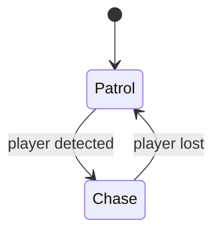
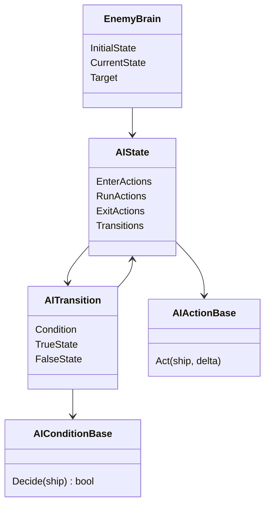
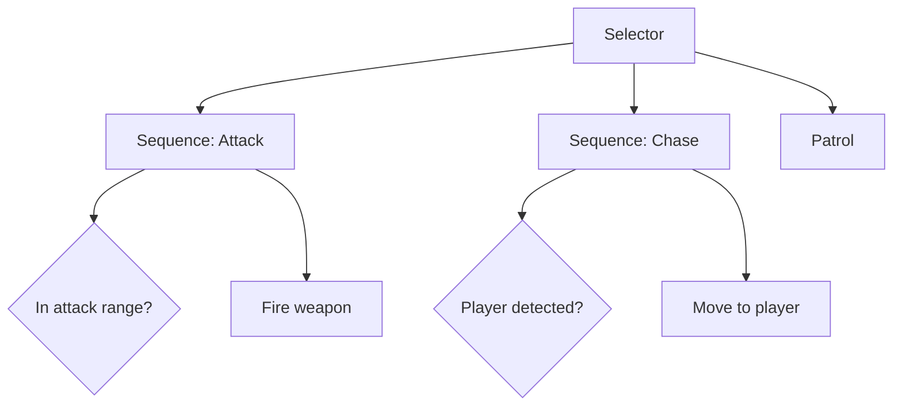

# Enemy AI with Finite-State Machines

Before we write any code, this article covers what we mean by "enemy AI" in games, why finite-state machines (FSMs) are the usual starting point, and which other patterns you will meet later.

## What game AI is (and is not)

Game AI is not about intelligence. It is about **believable behaviour that is cheap to compute, predictable to debug, and easy for designers to tune**. An enemy that patrols, notices you, chases you and gives up looks smart to the player, even if the code behind it is a handful of `if` statements.

Most enemy AI is built from three layers:

| Layer | Question | Example in our project |
|---|---|---|
| **Sensing** | What does the enemy know? | Is the player within detection range? |
| **Decision making** | What should it do now? | Patrol or chase? |
| **Acting** | How does it do it? | Find a path (A*), turn, move forward |

We have already built the acting layer's hardest part, pathfinding. This unit is about decision making.

## Finite-State Machines

An FSM describes an enemy as being in **exactly one state at a time**. Each state defines what the enemy does while it is there, and **transitions** define when it moves to another state.



An FSM has four parts:

- **States**: the modes of behaviour (`Patrol`, `Chase`).
- **Actions**: what happens on entering a state, every frame while in it, and on leaving it.
- **Transitions**: a link from one state to another.
- **Conditions**: the yes/no question that decides whether a transition fires.

### Why FSMs work well

- Easy to understand and to draw on a whiteboard.
- Easy to debug: "the enemy is in state X" tells you what it is doing.
- Cheap to run.
- Designers can reason about them without reading code.

### Where FSMs struggle

- **State explosion**: every new behaviour needs transitions to and from many other states. Ten states can mean up to 90 possible transitions.
- **Duplicated logic**: "if health is low, flee" has to be repeated in every state that allows fleeing.
- **No memory**: a state does not remember what came before it, so "return to what I was doing before" is awkward.

## The naive version and its problem

The first FSM most people write looks like this:

```csharp
enum State { Patrol, Chase }
State _state;

void Update(float delta)
{
    switch (_state)
    {
        case State.Patrol:
            Patrol(delta);
            if (PlayerInRange()) _state = State.Chase;
            break;
        case State.Chase:
            Chase(delta);
            if (!PlayerInRange()) _state = State.Patrol;
            break;
    }
}
```

This is fine for two states. As the enemy grows, the `switch` becomes a large file that only a programmer can edit, and every new enemy type means copying and modifying it.

## Our approach: data-driven FSM with Godot Resources

Instead of one big `switch`, we split the FSM into **small pieces, each a Godot `Resource`**. Programmers write the pieces once. Designers combine them in the editor.



- An **action** is one small behaviour: `TurnTowardTargetAction`, `MoveForwardAction`, `UpdatePathAction`.
- A **condition** is one small question: `IsPlayerInRange`.
- A **state** is a list of actions plus a list of transitions.
- The **brain** is a node on the enemy. It holds the current state and runs it every frame.

A `Patrol` state is then just a `.tres` file in the editor: *run* `PatrolWaypoint`, `UpdatePath`, `FollowPath`, `TurnTowardTarget`, `MoveForward`; *transition* to `Chase` when `IsPlayerInRange`. A new enemy type is a new combination of the same pieces, with no new code unless it needs a new behaviour.

### Design rules to keep in mind

1. **Actions should be small and do one thing.** If an action needs "and" in its description, split it.
2. **Resources are shared.** Every enemy that uses `Patrol.tres` uses the *same object*. An action must never store per-enemy data in its own fields. Keep that data on the enemy (or its brain) and pass the enemy in as a parameter. Forgetting this is the most common bug with this approach.
3. **Conditions should only read, never change anything.** Changes belong in actions.
4. **Order matters.** Actions in a state run top to bottom. For example, a path must be updated before the enemy tries to follow it.

## Other patterns

FSMs are not the only option. You should know what else exists and when it is a better fit.

### Hierarchical FSM

States contain sub-state-machines. `Combat` holds `Chase`, `Attack` and `TakeCover`, and one "player lost" transition on `Combat` replaces a transition on each of its children. This reduces duplication and state explosion.

### Pushdown automaton

An FSM with a **stack of states**. When something interrupts the enemy (say a distraction), you push `Investigate`; when done, you pop it and return to whatever it was doing. This solves the FSM's "no memory" problem.

### Behaviour Trees

A tree of nodes evaluated from the root each tick. Typical nodes:

- **Sequence**: run children in order, stop at the first failure.
- **Selector**: try children in order, stop at the first success.
- **Condition** and **Action** leaves.



Behaviour trees scale to large behaviours better than flat FSMs and are reusable, which is why they are common in AAA games. The price is more machinery and a different way of thinking: they are about priorities, not about "being in" a mode.

### Utility AI

Every possible action gets a **score** computed from the situation (health, distance, ammo), and the enemy does the highest-scoring one. Behaviour is smooth and emergent, with no hard transitions, but it is harder to predict and tune.

### GOAP (Goal-Oriented Action Planning)

The enemy has goals ("kill the player") and a set of actions with preconditions and effects. A planner, often using A*, finds a sequence of actions to reach the goal. It produces surprising, flexible behaviour, and is the most expensive and hardest to debug option.

### Quick comparison

| Pattern | Strengths | Weaknesses | Good for |
|---|---|---|---|
| FSM | Simple, predictable, debuggable | State explosion, duplication | Small to medium behaviours |
| Hierarchical FSM | Less duplication | More concepts | Larger FSM-based enemies |
| Pushdown automaton | Remembers previous state | Stack can get confusing | Interruptions |
| Behaviour tree | Modular, scales well | More setup | Complex, reusable behaviours |
| Utility AI | Smooth, adaptive | Hard to tune and predict | Many competing needs |
| GOAP | Flexible, emergent | Costly, hard to debug | Rich, open-ended agents |

Rule of thumb: **start with an FSM**. Move to something else only when the FSM starts hurting.

## Common pitfalls

- **Flickering between states.** If "player in range" flips every frame at the boundary, the enemy twitches between `Patrol` and `Chase`. Use hysteresis (a larger range to *lose* the player than to *notice* them) or a minimum time in state.
- **Doing expensive work every frame.** Pathfinding does not need to run every frame. Refresh on a timer.
- **No way to see what the AI is doing.** Always add a debug display of the current state. It saves hours.
- **Putting everything in conditions.** A condition that changes things becomes impossible to reason about.

## What we will do in class

1. Look at the current `Patrol` and `Chase` behaviours built from Resources.
2. Walk through `EnemyBrain`, `AIState` and `AITransition`.
3. Add a new action and a new condition.
4. Build a new state from existing pieces in the editor, with no code.
5. Discuss what breaks, and how another pattern from this article would address it.

## Further reading

- [*Game AI Pro*](https://www.gameaipro.com/) (free online chapters), especially the chapters on behaviour trees and utility AI.
- [*Programming Game AI by Example*](https://books.google.fi/books?id=gDLpyWtFacYC&printsec=frontcover&redir_esc=y#v=onepage&q&f=false), Mat Buckland, for FSMs.
- [Dave Mark, *Behavioral Mathematics for Game AI*](https://www.amazon.com/dp/1584506849?lv=shuf&channelId=500&plpRedirect=mhFallback), for utility AI.
- [Jeff Orkin's papers on GOAP in *F.E.A.R.*](https://www.gamedevs.org/uploads/three-states-plan-ai-of-fear.pdf)
